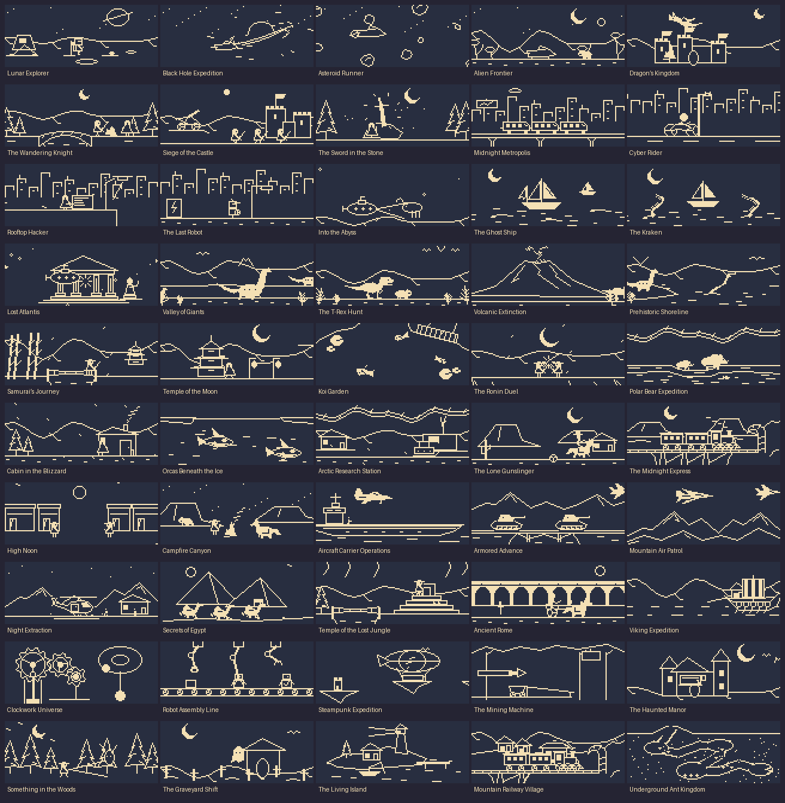

# Pixel Shelf film index

The 50 new films each run for two minutes. Shoreline Penguin runs for three minutes. The complete collection plays for 103 minutes at 10 frames per second.

[Machine-readable manifest](Shelf.xml) · [Player and playlist controls](README.md)

## Arctic Wilderness

| Film | Drawing module and function | Playback file |
| --- | --- | --- |
| Shoreline Penguin | [DrawShore.py](DrawShore.py) · render | [penguin](Shore.frames) |
| Polar Bear Expedition | [art/arctic.py](art/arctic.py) · bears | [arctic_bears](films/arctic_bears.frames) |
| Cabin in the Blizzard | [art/arctic.py](art/arctic.py) · cabin | [arctic_cabin](films/arctic_cabin.frames) |
| Orcas Beneath the Ice | [art/arctic.py](art/arctic.py) · orcas | [arctic_orcas](films/arctic_orcas.frames) |
| Arctic Research Station | [art/arctic.py](art/arctic.py) · station | [arctic_station](films/arctic_station.frames) |

## Deep Space

| Film | Drawing module and function | Playback file |
| --- | --- | --- |
| Lunar Explorer | [art/space.py](art/space.py) · lunar_explorer | [space_lunar_explorer](films/space_lunar_explorer.frames) |
| Black Hole Expedition | [art/space.py](art/space.py) · black_hole_expedition | [space_black_hole_expedition](films/space_black_hole_expedition.frames) |
| Asteroid Runner | [art/space.py](art/space.py) · asteroid_runner | [space_asteroid_runner](films/space_asteroid_runner.frames) |
| Alien Frontier | [art/space.py](art/space.py) · alien_frontier | [space_alien_frontier](films/space_alien_frontier.frames) |

## Medieval Legends

| Film | Drawing module and function | Playback file |
| --- | --- | --- |
| Dragon’s Kingdom | [art/legends.py](art/legends.py) · dragons_kingdom | [legends_dragons_kingdom](films/legends_dragons_kingdom.frames) |
| The Wandering Knight | [art/legends.py](art/legends.py) · wandering_knight | [legends_wandering_knight](films/legends_wandering_knight.frames) |
| Siege of the Castle | [art/legends.py](art/legends.py) · siege | [legends_siege](films/legends_siege.frames) |
| The Sword in the Stone | [art/legends.py](art/legends.py) · sword_stone | [legends_sword_stone](films/legends_sword_stone.frames) |

## Cyberpunk & Neon Cities

| Film | Drawing module and function | Playback file |
| --- | --- | --- |
| Midnight Metropolis | [art/neon.py](art/neon.py) · metro | [neon_metro](films/neon_metro.frames) |
| Cyber Rider | [art/neon.py](art/neon.py) · cyber_rider | [neon_cyber_rider](films/neon_cyber_rider.frames) |
| Rooftop Hacker | [art/neon.py](art/neon.py) · rooftop | [neon_rooftop](films/neon_rooftop.frames) |
| The Last Robot | [art/neon.py](art/neon.py) · last_robot | [neon_last_robot](films/neon_last_robot.frames) |

## Ocean Mysteries

| Film | Drawing module and function | Playback file |
| --- | --- | --- |
| Into the Abyss | [art/ocean.py](art/ocean.py) · abyss | [ocean_abyss](films/ocean_abyss.frames) |
| The Ghost Ship | [art/ocean.py](art/ocean.py) · ghost_ship | [ocean_ghost_ship](films/ocean_ghost_ship.frames) |
| The Kraken | [art/ocean.py](art/ocean.py) · kraken | [ocean_kraken](films/ocean_kraken.frames) |
| Lost Atlantis | [art/ocean.py](art/ocean.py) · atlantis | [ocean_atlantis](films/ocean_atlantis.frames) |

## Jurassic World

| Film | Drawing module and function | Playback file |
| --- | --- | --- |
| Valley of Giants | [art/jurassic.py](art/jurassic.py) · giants | [jurassic_giants](films/jurassic_giants.frames) |
| The T-Rex Hunt | [art/jurassic.py](art/jurassic.py) · rex_hunt | [jurassic_rex_hunt](films/jurassic_rex_hunt.frames) |
| Volcanic Extinction | [art/jurassic.py](art/jurassic.py) · volcano | [jurassic_volcano](films/jurassic_volcano.frames) |
| Prehistoric Shoreline | [art/jurassic.py](art/jurassic.py) · shoreline | [jurassic_shoreline](films/jurassic_shoreline.frames) |

## Japanese Landscapes

| Film | Drawing module and function | Playback file |
| --- | --- | --- |
| Samurai’s Journey | [art/japan.py](art/japan.py) · samurai | [japan_samurai](films/japan_samurai.frames) |
| Temple of the Moon | [art/japan.py](art/japan.py) · temple_moon | [japan_temple_moon](films/japan_temple_moon.frames) |
| Koi Garden | [art/japan.py](art/japan.py) · koi | [japan_koi](films/japan_koi.frames) |
| The Ronin Duel | [art/japan.py](art/japan.py) · ronin | [japan_ronin](films/japan_ronin.frames) |

## The Wild West

| Film | Drawing module and function | Playback file |
| --- | --- | --- |
| The Lone Gunslinger | [art/west.py](art/west.py) · gunslinger | [west_gunslinger](films/west_gunslinger.frames) |
| The Midnight Express | [art/west.py](art/west.py) · express | [west_express](films/west_express.frames) |
| High Noon | [art/west.py](art/west.py) · noon | [west_noon](films/west_noon.frames) |
| Campfire Canyon | [art/west.py](art/west.py) · canyon | [west_canyon](films/west_canyon.frames) |

## Military & Aviation

| Film | Drawing module and function | Playback file |
| --- | --- | --- |
| Aircraft Carrier Operations | [art/flight.py](art/flight.py) · carrier | [flight_carrier](films/flight_carrier.frames) |
| Armored Advance | [art/flight.py](art/flight.py) · armored | [flight_armored](films/flight_armored.frames) |
| Mountain Air Patrol | [art/flight.py](art/flight.py) · patrol | [flight_patrol](films/flight_patrol.frames) |
| Night Extraction | [art/flight.py](art/flight.py) · extraction | [flight_extraction](films/flight_extraction.frames) |

## Ancient Civilizations

| Film | Drawing module and function | Playback file |
| --- | --- | --- |
| Secrets of Egypt | [art/ancient.py](art/ancient.py) · egypt | [ancient_egypt](films/ancient_egypt.frames) |
| Temple of the Lost Jungle | [art/ancient.py](art/ancient.py) · jungle_temple | [ancient_jungle_temple](films/ancient_jungle_temple.frames) |
| Ancient Rome | [art/ancient.py](art/ancient.py) · rome | [ancient_rome](films/ancient_rome.frames) |
| Viking Expedition | [art/ancient.py](art/ancient.py) · vikings | [ancient_vikings](films/ancient_vikings.frames) |

## Mechanical Worlds

| Film | Drawing module and function | Playback file |
| --- | --- | --- |
| Clockwork Universe | [art/machines.py](art/machines.py) · clockwork | [machines_clockwork](films/machines_clockwork.frames) |
| Robot Assembly Line | [art/machines.py](art/machines.py) · assembly | [machines_assembly](films/machines_assembly.frames) |
| Steampunk Expedition | [art/machines.py](art/machines.py) · steampunk | [machines_steampunk](films/machines_steampunk.frames) |
| The Mining Machine | [art/machines.py](art/machines.py) · mining | [machines_mining](films/machines_mining.frames) |

## Supernatural Horror

| Film | Drawing module and function | Playback file |
| --- | --- | --- |
| The Haunted Manor | [art/haunts.py](art/haunts.py) · manor | [haunts_manor](films/haunts_manor.frames) |
| Something in the Woods | [art/haunts.py](art/haunts.py) · woods | [haunts_woods](films/haunts_woods.frames) |
| The Graveyard Shift | [art/haunts.py](art/haunts.py) · graveyard | [haunts_graveyard](films/haunts_graveyard.frames) |

## Miniature Living Worlds

| Film | Drawing module and function | Playback file |
| --- | --- | --- |
| The Living Island | [art/worlds.py](art/worlds.py) · island | [worlds_island](films/worlds_island.frames) |
| Mountain Railway Village | [art/worlds.py](art/worlds.py) · village | [worlds_village](films/worlds_village.frames) |
| Underground Ant Kingdom | [art/worlds.py](art/worlds.py) · ants | [worlds_ants](films/worlds_ants.frames) |

## Authoring and tuning

The drawing modules use Pillow at 128 × 52 in one-bit mode. Each film has its own timeline. The shared stage supplies pixel shapes, actors and timing helpers. The player streams prebuilt frames using the display dimensions and cadence verified on this Arctis Nova Pro Wireless.

Edit a drawing function, then run `python art/bake.py --category-module ocean` from this directory to rebuild that module. Use `python art/bake.py` for the whole library and `python art/index_library.py` to refresh the index and audit the files. Register future films in `art/catalog.py` and restart the picker after a catalog change.

Rebuild the Windows app with the .NET Framework C# compiler, including both `PixelShelf.cs` and `Playback.cs` and references to System.Windows.Forms, System.Drawing and System.Xml.Linq. Playback itself needs Windows PowerShell and SteelSeries GG.
