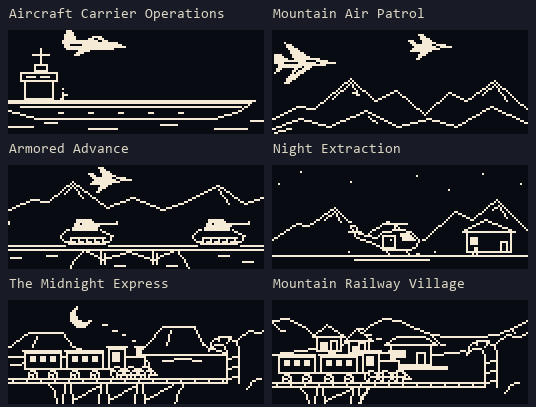

# Pixel Shelf

A small Windows tray app for the **128 × 52 OLED on the SteelSeries Arctis Nova Pro Wireless base station**. Browse 51 monochrome animations across 13 categories. Preview a film, send it to the headset base, or build a playlist. The collection runs for 103 minutes end to end.



## Install on Windows

1. Download [PixelShelf-1.0.0.msi](dist/PixelShelf-1.0.0.msi). On the GitHub file page, choose **Download raw file**.
2. Run the installer and select **Install**. Setup installs the app and all films for your Windows account.
3. Choose **Open shelf** at the end of setup, or open **Pixel Shelf** from Start.
4. For physical playback, connect the base station and start **SteelSeries GG** with Engine enabled. Select a film and press **Play**.

The desktop preview works independently of the headset. The Windows player uses .NET Framework 4.x and Windows PowerShell 5.1. All animations are included in the installer. The [illustrated catalog](Library.md) lists each film and its source.

## Controls

| Action | Control |
| --- | --- |
| Show or hide the shelf | Hold `/` and tap `F10`, or use keypad Divide with `F10` |
| Find a film | Choose a category or type part of the title in **Find** |
| Start playback | **Play**, **Enter**, or double-click a film |
| Choose how it ends | Select **Play once** or **Loop**, then press **Play** |
| Build a playlist | **+ Queue**, then **Playlist** to reorder, remove, or play |
| Release the OLED | **Stop** |
| Hide the picker during playback | **Esc** or close the window |
| Exit the app | Choose **Quit Pixel Shelf** in the tray menu |

The playlist plays in the order shown and accepts duplicates. Pressing **Play** takes a snapshot of the queue, so edits take effect the next time playback starts. Playlist order and mode are saved in `%LOCALAPPDATA%\PixelShelf\playlist.xml`.

## Repair or uninstall

Run the same MSI again to repair or remove Pixel Shelf, or remove it from Windows **Settings → Apps**. Setup keeps your saved playlist. If upgrading from a portable copy, quit that copy from its tray menu before starting the installed app.

## Build from source

The repository includes the complete artwork sources and the packed playback files. From the project directory on Windows:

```powershell
.\Build-App.ps1
py -3.12 packaging\build_msi.py
```

The first command uses the Windows .NET Framework compiler. The second builds a fresh executable and packages the catalog into `dist/PixelShelf-1.0.0.msi` using the Windows standard library in CPython 3.12.

To change the artwork, install Pillow in your Python authoring environment. Run `python DrawShore.py` to regenerate the three-minute penguin or `python art/bake.py` to regenerate the other fifty films. Run `python art/index_library.py` and `python art/check_staging.py` to check the frame streams, index and scene geometry.

## Display connection

The player discovers SteelSeries Engine through its local `coreProps.json` and sends packed monochrome frames over the loopback GameSense connection. If the preview moves but the OLED stays idle, check **GG → Engine → Apps → ABI OLED Companion** and its screen binding. The optional source utility `AbiOled.ps1` shares this registration and supports a display test, custom text, and an Arena Breakout Infinite application-open timer.

[SteelSeries GameSense SDK](https://github.com/SteelSeries/gamesense-sdk)
